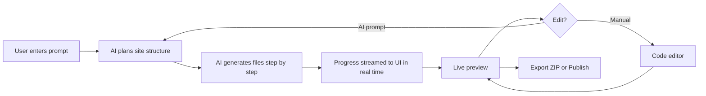

# AI Website Builder

> Generate complete React websites from a simple text prompt, watch the AI build it step by step in real time, then edit, export or publish it in a few clicks.

AI Website Builder is a real-world AI SaaS application. Describe the website you want, and the AI plans and builds it file by file while you track every step live. After generation you can keep refining the site by editing the source code yourself or by sending follow-up prompts to the AI. When you are happy with it, export the project or publish it with one click.

The project runs on a **free AI model from OpenRouter**, so you can build and run the whole application without paying for expensive AI APIs. **CodeRabbit** is used for automated AI code reviews throughout development.

---

## Table of Contents

- [Features](#features)
- [How It Works](#how-it-works)
- [Tech Stack](#tech-stack)
- [Getting Started](#getting-started)
- [Environment Variables](#environment-variables)
- [Project Structure](#project-structure)
- [Usage](#usage)
- [Code Review with CodeRabbit](#code-review-with-coderabbit)
- [Limitations](#limitations)
- [Future Scope](#future-scope)
- [Author](#author)
- [Contributing](#contributing)
- [License](#license)

---

## Features

- **Prompt-to-website:** Describe a site in plain English and get a complete React project.
- **Step-by-step generation:** The AI plans the structure, then creates components, pages, styles and routing one stage at a time.
- **Real-time progress tracking:** Watch each generation step stream live in the interface.
- **Live preview:** See the generated website render instantly in the browser.
- **Manual code editing:** Edit any file in a built-in code editor with a file explorer.
- **AI-powered edits:** Send follow-up prompts such as "make the theme dark and add a pricing section" and the AI updates your existing code.
- **Export and publish:** Download the project as a ZIP or publish it to a hosted link in a few clicks.
- **User accounts and dashboard:** Sign up, log in, and save your projects and generation history.
- **Zero AI cost:** Uses a free OpenRouter model.

## How It Works



## Tech Stack

> Update this table to match what you actually used.

| Layer | Technology |
|---|---|
| Frontend | React, Tailwind CSS, code editor component |
| Backend | Node.js (or Next.js API routes) |
| AI model | Free model via the [OpenRouter](https://openrouter.ai) API |
| Database | MongoDB
| Authentication | JWT or an auth provider |
| Code review | [CodeRabbit](https://coderabbit.ai) |
| Version control | Git and GitHub |
| Deployment | Vercel / cloud hosting |

## Getting Started

### Prerequisites

- [Node.js](https://nodejs.org) (v18 or later recommended)
- [Git](https://git-scm.com)
- A free [OpenRouter](https://openrouter.ai) API key
- A database instance (local or cloud)

### Installation

```bash
# 1. Clone the repository
git clone https://github.com/vishaljain-code/ai-website-builder.git
cd ai-website-builder

# 2. Install dependencies
npm install

# 3. Set up environment variables
cp .env.example .env
# then open .env and add your keys (see below)

# 4. Start the development server
npm run dev
```

Open [http://localhost:3000](http://localhost:3000) in your browser.

> Adjust the commands above if your project uses separate `client` and `server` folders or a different package manager.

## Environment Variables

Create a `.env` file in the project root:

```env
# OpenRouter
OPENROUTER_API_KEY=your_openrouter_api_key
OPENROUTER_MODEL=your_chosen_free_model_id

# Database
DATABASE_URL=your_database_connection_string

# Authentication
JWT_SECRET=your_secret_key
```

Never commit your `.env` file. Add it to `.gitignore`.

## Project Structure

The project is split into a React (Vite) frontend and a Node.js backend.

```text
builder-ai/
├── client/                  # Frontend (React + Vite)
│   ├── public/              # Static assets
│   ├── src/
│   │   └── api/             # API helper (api.js) for calling the backend
│   ├── .env                 # VITE_BASE_URL (backend URL)
│   ├── index.html
│   ├── vite.config.js
│   └── package.json
├── server/                  # Backend (Node.js)
│   ├── config/              # App and database configuration
│   ├── controllers/         # Request handlers (e.g. authController.js)
│   ├── middleware/          # Custom middleware
│   ├── models/              # Database models
│   ├── routes/              # API routes
│   │   ├── authRoutes.js
│   │   └── projectRoutes.js
│   ├── services/            # Business logic and AI integration
│   ├── .env                 # Server environment variables
│   ├── server.js            # Server entry point
│   └── package.json
├── .gitignore
└── README.md
```

## Usage

1. **Sign up or log in** to your account.
2. **Enter a prompt** describing your website, for example: *"A portfolio website for a photographer with a gallery and a contact form."*
3. **Watch the build** as the AI generates your project step by step.
4. **Review the live preview** of the generated site.
5. **Refine it** by editing the code manually or by sending another prompt.
6. **Export** the project as a ZIP, or **publish** it to get a shareable link.

## Code Review with CodeRabbit

This project uses CodeRabbit to review pull requests automatically. It suggests improvements, flags potential bugs, and helps keep the code clean and production-ready. To use it on your fork, install the CodeRabbit GitHub app on your repository and open a pull request.

## Limitations

- Output quality depends on the free AI model and on how clear the prompt is.
- Free models can have rate limits and slower responses.
- Generated websites are front-end focused and may need manual refinement for complex logic.

## Future Scope

- Backend and database generation
- Support for other frameworks such as Next.js and Vue
- Custom domains and team collaboration
- Template library and image generation
- Version history with undo/redo for AI edits
- Optional support for stronger paid models

## Author

**Vishal Jain**

- GitHub: [@vishaljain-code](https://github.com/vishaljain-code)
- LinkedIn: [vishal-jainai27](https://www.linkedin.com/in/vishal-jainai27/)

## Contributing

Contributions are welcome. Fork the repository, create a feature branch, commit your changes and open a pull request. CodeRabbit will review it automatically.

## License

This project is licensed under the MIT License. See the `LICENSE` file for details.
